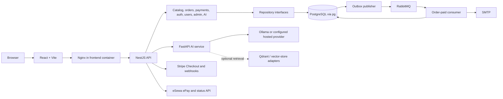

# System architecture

Atlas Commerce Lab is a multi-service application with a NestJS modular monolith at its center. The frontend treats NestJS as its public API; the backend coordinates persistence, AI, and payment providers.

## System map

## Request and ownership boundaries

| Boundary | Responsibility |
|---|---|
| React frontend | User interface, client-side state, and API calls. It does not own authoritative prices or payment state. |
| NestJS controllers | HTTP validation and response mapping. |
| NestJS services | Commerce orchestration, payment workflows, authentication, and downstream coordination. |
| Repository interfaces | Persistence contracts consumed by services. |
| PostgreSQL repositories | Parameterized SQL, transactions, and mapping database errors into application-level behavior. |
| FastAPI AI service | Model-provider selection, prompt/event handling, and optional retrieval integration. |
| Provider adapters | Vendor-specific model request and streaming protocols. |

## Services and data stores

- `frontend/` builds a React/Vite SPA and serves it with Nginx in the Compose deployment.
- `backend/` is a NestJS modular monolith. `backend/src/app.module.ts` wires catalog, payment, user, authentication, order, admin, AI, and database modules.
- PostgreSQL is the commerce and application database. The backend uses the `pg` pool and repository implementations; it does not use MongoDB or Mongoose.
- `ai-service/` is a FastAPI application. It supports Ollama, mock, OpenAI, Claude, Gemini, and OpenAI-compatible provider adapters. Retrieval defaults to disabled; Qdrant retrieval is optional.
- Stripe and eSewa are external payment providers. Order-paid inventory and email effects flow through RabbitMQ after PostgreSQL outbox dispatch; password-reset mail remains direct SMTP.
- RabbitMQ runs as a local Compose service for the learning topology. PostgreSQL remains the atomic event source and buffers payment events while RabbitMQ is disconnected.
- `ai-service/app/jobs/ingestion.py` can enqueue Qdrant indexing through Redis/RQ. Compose does not currently define a Redis or RQ worker service, so that path requires separately provisioned infrastructure.

## Request flows

### Commerce and payments

1. The browser sends a catalog or checkout request to NestJS through the frontend proxy.
2. A controller validates the input and calls a domain service.
3. The service calls repository interfaces for database reads and writes.
4. Checkout is priced by the backend and delegated to a Stripe or eSewa provider adapter.
5. Provider callbacks are verified before the backend changes order state. The transaction records the order update and outbox event; an outbox publisher forwards it to RabbitMQ for inventory and email consumers.

### AI generation

1. The browser calls the NestJS AI gateway.
2. NestJS forwards the request to FastAPI and propagates stream cancellation.
3. FastAPI resolves the configured model provider, prepares the prompt, and emits stable NDJSON events.
4. If retrieval is configured, the retriever supplies evidence. Retrieval is not active by default.

## Runtime entry points

- NestJS bootstrap: `backend/src/main.ts`.
- NestJS module composition: `backend/src/app.module.ts`.
- FastAPI application factory: `ai-service/app/main.py`.
- Compose topology: `docker-compose.yml`.

## Known limitations and unresolved contracts

- Compose and `PostgresService` use the required `POSTGRES_URL` connection string. Startup fails after connection retries are exhausted, and `/health` reports HTTP 503 when database checks fail.
- AI concurrency limits are process-local. Multiple Uvicorn workers or replicas multiply the effective number of simultaneous model calls.
- Retrieval and document ingestion are optional capabilities. Redis/RQ is not part of the checked-in Compose topology; RabbitMQ is used for order-paid events.
- The root README and some historical docs may still contain older MongoDB/Mongoose claims. Treat implementation, migrations, Compose, and current ADRs as the source of truth until those documents are reconciled.
