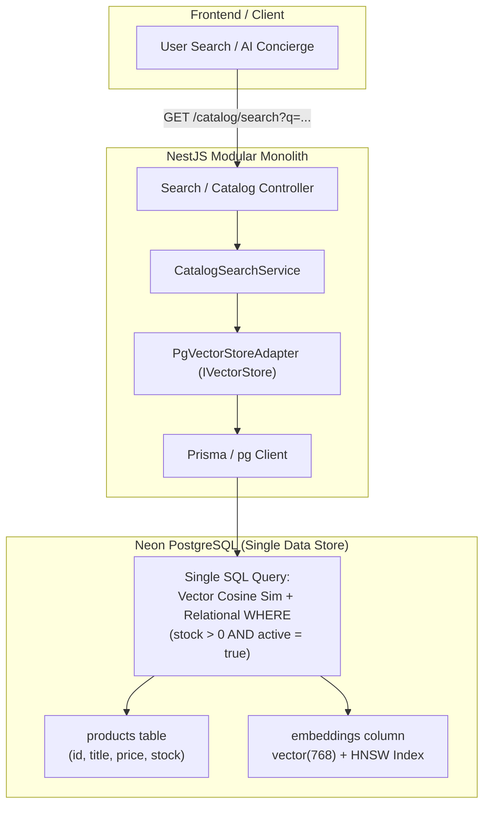
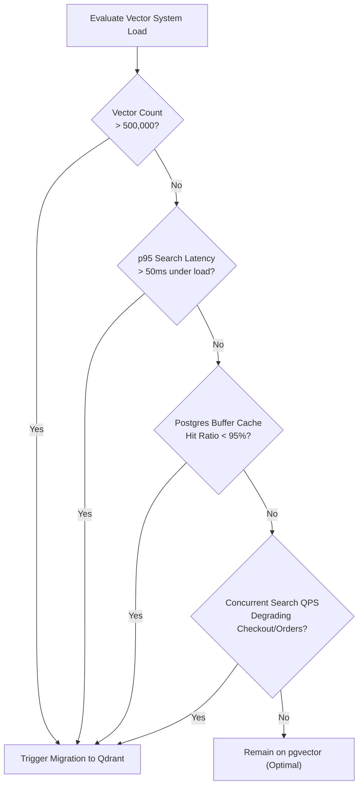

# ADR-011: Vector Search Strategy — pgvector First, Scale to Qdrant

**Status:** Accepted  
**Date:** 2026-10  
**Decision Makers:** Sujan Shrestha, Architecture Team  
**Related:** ADR-001 (NestJS Backend Gateway), ADR-003 (PostgreSQL for Relational Data), ADR-004 (Vector Embeddings), ADR-010 (Modular Monolith)

---

## 1. Executive Summary & Context

As **Atlas Commerce Lab** incorporates semantic search, AI product recommendations, and agentic assistant memory, the platform requires an approximate nearest neighbor (ANN) vector similarity search engine.

### The Architectural Dilemma

Modern engineering teams face a common fork in AI system design:
1. **Dedicated Vector Database (e.g., Qdrant, Milvus, Pinecone):** Built from the ground up for high-throughput ANN vector indexing with advanced quantization and distributed clustering.
2. **Relational Extension (e.g., pgvector on PostgreSQL / Neon):** Storing high-dimensional vector embeddings directly as a column type within existing relational tables (`products`, `chat_messages`), querying with SQL similarity operators (`<=>`, `<#>`).

### Requirements & Constraints

* **Current Scale:** 10,000 to 100,000 product SKUs; moderate concurrent search traffic.
* **Database Infrastructure:** Already running **PostgreSQL on Neon DB** with serverless pooling and ACID compliance.
* **Team & Operational Overhead:** Solo engineer / lean engineering team; must minimize multi-database maintenance, backup divergence, and operational surface area.
* **Correctness & Consistency:** Product prices, inventory levels, and visibility flags must never desynchronize from semantic search results.

---

## 2. Decision

**We adopt a Pragmatic Two-Phase Evolution Strategy:**

1. **Phase 1 (Production Launch & Growth — Up to ~500,000 Vectors):**
   * Use **`pgvector`** hosted directly within our existing **Neon PostgreSQL** database.
   * Embeddings reside co-located in the `products` table or a 1-to-1 extension table (`product_embeddings`).
   * Eliminates dual-write bugs, eliminates secondary database maintenance, and preserves complete ACID transaction guarantees.
2. **Phase 2 (High-Scale Horizon — > 500k–1M Vectors OR Search Latency > 50ms):**
   * Migrate vector search to **`Qdrant`** as an isolated vector search microservice.
   * Decouple primary OLTP transactional databases from compute-heavy HNSW graph traversals.
3. **Decoupled Architecture Rule (Adapter Pattern):**
   * The NestJS application layer MUST communicate through a generic vector store interface (`IVectorStore`). 
   * Neither business controllers nor services may directly import vendor-specific database SDKs for vector search.

---

## 3. Architecture Diagrams

### Phase 1: Co-located `pgvector` (Simplicity & Transactional Integrity)



---

### Phase 2: Dedicated Qdrant Engine (High-Throughput Scale)

```mermaid
flowchart TD
    subgraph Backend["NestJS Backend"]
        Service["CatalogSearchService"]
        QdrantAdapter["QdrantStoreAdapter (IVectorStore)"]
        Outbox["Transactional Outbox / CDC"]
    end

    subgraph Neon["Neon PostgreSQL (OLTP)"]
        SQLDB["Relational Data Only\n(Orders, Users, Stock, Payments)"]
    end

    subgraph Qdrant["Qdrant Vector Cluster (ANN Engine)"]
        RustCore["Rust Engine + SIMD HNSW"]
        Quant["Scalar / Product Quantization"]
        Payload["Payload Index (Filter Metadata)"]
    end

    Service -->|Query Vectors| QdrantAdapter
    QdrantAdapter -->|gRPC / REST (< 10ms)| Qdrant
    SQLDB -->|Change Data Capture / Event Bus| Outbox
    Outbox -->|Async Upsert / Sync| Qdrant
```

---

### Migration Decision Tree



---

## 4. In-Depth Technical Comparison Matrix

| Dimension | `pgvector` (PostgreSQL) | `Qdrant` (Dedicated Vector DB) | Atlas Commerce Decision Rationale |
| :--- | :--- | :--- | :--- |
| **Primary Implementation** | C extension running inside Postgres engine | Standalone daemon written in Rust | `pgvector` requires 0 additional daemons. |
| **Index Types** | HNSW, IVFFlat | HNSW with custom memory payload index | Both support modern HNSW graphs. |
| **Latency (100k items)** | **8 – 20 ms** | **4 – 10 ms** | Unnoticeable difference for e-commerce search. |
| **Latency (5M+ items)** | 40 – 120 ms (without memory tuning) | **6 – 15 ms** (with quantization) | Qdrant excels at multimillion scales. |
| **Throughput (QPS)** | Moderate (~150–400 QPS per instance) | **High (> 2,500+ QPS per node)** | We need < 50 QPS today. `pgvector` easily handles this. |
| **Quantization** | Limited / experimental | **Scalar & Product Quantization (SQ/PQ)** | Qdrant reduces vector RAM footprint by up to 90%. |
| **Filtering Strategy** | Native SQL: `WHERE in_stock = true AND price < 100` | Pre-filtered HNSW graph using payload index | SQL `JOIN`s in `pgvector` are simpler to maintain. |
| **Data Consistency** | **Strict ACID (Atomic)** | Eventual consistency (requires async sync pipeline) | `pgvector` eliminates catalog sync drift completely. |
| **Infrastructure Cost** | **$0 extra** (included in current Neon plan) | $30–$200/mo (managed) or extra RAM VM | `pgvector` saves cloud infrastructure budget. |
| **Backup / Disaster Recovery** | Standard `pg_dump` or Neon point-in-time snapshot | Separate snapshotting & backup policies | One backup covers both relational and vector data in Phase 1. |

---

## 5. The "Dual-Write Problem" & Why pgvector Wins Early

In production e-commerce, **consistency matters more than raw microsecond search speed**.

### The Failure Mode with Standalone Vector Databases:
1. An admin updates a product price from **$50 to $20** and sets `stock = 0`.
2. The transaction commits successfully in Postgres.
3. The background worker attempts to sync the update to Qdrant.
4. **Network hiccup, rate limit, or worker crash occurs.**
5. **Result:** Qdrant continues returning the out-of-stock item at the wrong price during vector search queries. The user clicks "Buy" and gets an error at checkout.

### How `pgvector` Solves This:
```sql
BEGIN;
UPDATE products 
SET price = 20.00, stock = 0, embedding = $1 
WHERE id = $2;
COMMIT;
```
* **Atomicity is guaranteed.** If the transaction succeeds, the vector search, product price, and inventory are updated in the exact same millisecond. If it fails, all roll back together.

---

## 6. Adapter Pattern: Future-Proofing the Codebase

To ensure zero architectural lock-in, all vector operations MUST implement the following interface:

```typescript
// src/ai/interfaces/vector-store.interface.ts

export interface VectorRecord<T = Record<string, any>> {
  id: string;
  vector: number[];
  payload: T;
}

export interface VectorFilter {
  category?: string;
  minPrice?: number;
  maxPrice?: number;
  inStockOnly?: boolean;
}

export interface VectorSearchResult<T = Record<string, any>> {
  id: string;
  score: number;
  payload: T;
}

export interface IVectorStore {
  upsert(records: VectorRecord[]): Promise<void>;
  search(queryVector: number[], limit: number, filter?: VectorFilter): Promise<VectorSearchResult[]>;
  delete(ids: string[]): Promise<void>;
}
```

### Swapping Providers via NestJS Dependency Injection:

```typescript
// src/ai/vector.module.ts
@Module({
  providers: [
    {
      provide: 'IVectorStore',
      // In Phase 1:
      useClass: PgVectorStoreAdapter,
      // In Phase 2: Swap with zero change to business logic:
      // useClass: QdrantStoreAdapter,
    },
  ],
  exports: ['IVectorStore'],
})
export class VectorModule {}
```

---

## 7. Concrete Migration Triggers (Checklist for Phase 2)

Do not migrate on guesswork. Trigger the transition to Qdrant if and only if **any two** of these thresholds are breached:

- [ ] **Vector Count:** Corpus exceeds **500,000 vectors** (768 or 1536 dimensions).
- [ ] **RAM Exhaustion:** The Postgres buffer cache hit ratio drops below **95%** due to HNSW index memory consumption.
- [ ] **Latency SLA Violation:** 95th percentile semantic search latency exceeds **50ms**.
- [ ] **Search Concurrency Spikes:** Vector queries cause CPU throttling on Postgres, slowing down transactional payments or user order creation.

---

## 8. Senior Staff / System Design Interview Talking Points

Use these concise, high-impact architectural insights during technical discussions and interviews:

### Q1: "Why didn't you start with a dedicated vector database like Qdrant or Milvus immediately?"
> **Answer:** *"Starting with a standalone vector DB when managing < 100k items introduces premature optimization and the dual-write problem. A standalone vector database creates a distributed system with eventual consistency bugs between PostgreSQL and the vector engine. By co-locating vectors inside PostgreSQL via `pgvector`, we get strict ACID transactions, zero data-sync pipeline overhead, zero extra infrastructure costs, and single-point disaster recovery. We architected our data layer behind an `IVectorStore` adapter interface so that when scale demands dedicated quantization or isolated compute, swapping to Qdrant is an infrastructure drop-in without touching domain logic."*

### Q2: "What are the core bottlenecks of `pgvector` at high scale?"
> **Answer:** *"First is the PostgreSQL process architecture: Postgres forks processes per connection, meaning HNSW memory is not as efficiently shared or compressed across cores as in a multithreaded Rust daemon like Qdrant. Second is lack of advanced compression: Qdrant offers native 8-bit scalar and product quantization (SQ/PQ), storing graphs on disk while keeping compressed vectors in RAM. Third is VACUUM bloat: high-frequency vector updates in PostgreSQL cause dead tuple churn that degrades HNSW graph indexing performance."*

### Q3: "How does filtering work during vector similarity search, and how do pgvector and Qdrant differ?"
> **Answer:** *"There are three filtering strategies: pre-filtering, post-filtering, and single-stage filtered search. Postgres traditionally does pre-filtering (filtering relational columns first, which breaks ANN index graph navigation) or post-filtering (searching top-K vectors then filtering out non-matches, risking empty results). Qdrant implements single-stage filtering directly inside the HNSW graph traversal using payload indexes. Modern `pgvector` (v0.5+) has mitigated this with iterative index scans, but Qdrant remains superior for complex multifaceted boolean query filters."*

### Q4: "How would you execute a zero-downtime migration from `pgvector` to `Qdrant`?"
> **Answer:** *"We use the standard 4-step dual-write migration pattern:
> 1. Deploy the `Qdrant` instance and configure an asynchronous dual-write adapter that writes embeddings to both `pgvector` and `Qdrant` on product changes.
> 2. Run a background batch worker to backfill historical embeddings from Postgres into Qdrant.
> 3. Enable shadow reads (query Qdrant in parallel with pgvector, log latency/recall metrics, discard output to verify parity).
> 4. Flip the primary `IVectorStore` injection provider to Qdrant and decommission the `pgvector` index."*

---

## 9. Conclusion & Immediate Action Items

* **Keep Qdrant container disabled / optional in development** if not currently saturated.
* **Store catalog embeddings in PostgreSQL** via standard `vector` extensions supported in our cloud Neon instance.
* **Maintain the `IVectorStore` abstraction** to protect codebase architecture against vendor lock-in.
