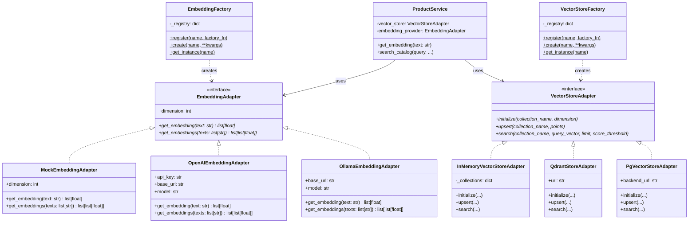
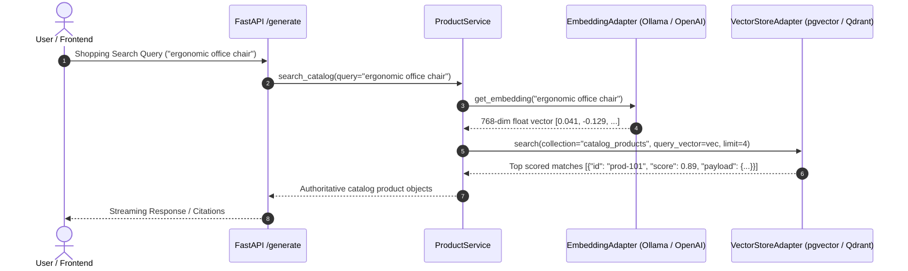

# ADR-012: Pluggable AI Provider Architecture — Adapter & Factory Patterns

**Status:** Accepted  
**Date:** 2026-10  
**Decision Makers:** Sujan Shrestha, Architecture Team  
**Related:** ADR-001 (NestJS Gateway), ADR-005 (Separate Python AI Service), ADR-011 (Vector Search Strategy)

---

## 1. Executive Summary & Context

As **Atlas Commerce** scales its AI features (semantic product discovery, multi-turn AI concierge, retrieval-augmented generation), our application layer must interact with two core external AI infrastructure components:
1. **Embedding & LLM Inference Providers:** (e.g., local **Ollama** during local development, **OpenAI** / **Claude** / **Gemini** in cloud staging/production, or private hosted models like vLLM).
2. **Vector Storage & ANN Retrieval Engines:** (e.g., **pgvector** in Neon PostgreSQL, **Qdrant** cluster, or in-memory mock stores).

### The Architectural Problem

Initially, domain services such as `ProductService` directly made HTTP requests to `http://localhost:11434/api/embed` (Ollama) and were coupled to hardcoded vector stores. This introduced serious architectural vulnerabilities:
* **Vendor Lock-in & Inflexibility:** Switching from local Ollama embeddings (`nomic-embed-text`) to cloud embeddings (`text-embedding-3-small`) required rewriting application service logic.
* **Testing Friction:** Unit tests and CI pipelines required running live Ollama and PostgreSQL containers, causing slow, brittle tests.
* **Violation of SOLID Principles:**
  * **Open/Closed Principle (OCP):** Adding a new provider required modifying existing business code with scattered `if/else` checks.
  * **Dependency Inversion Principle (DIP):** High-level domain services (`ProductService`) depended directly on low-level I/O communication details rather than abstractions.

---

## 2. Decision

We establish an **Enterprise Pluggable Provider Architecture** across both AI inference/embeddings and vector databases using the **Adapter Pattern**, **Factory Pattern with Dynamic Open Registry**, and **Constructor Dependency Injection**.

### Core Architecture Rules:

1. **Strict Interface Contracts (Adapter Pattern):**
   * **`EmbeddingAdapter`**: Declares abstract methods `get_embedding(text: str) -> list[float]`, `get_embeddings(texts: list[str]) -> list[list[float]]`, and read-only property `dimension -> int`.
   * **`VectorStoreAdapter`**: Declares abstract methods `initialize(collection, dimension)`, `upsert(collection, points)`, and `search(collection, query_vector, limit, score_threshold)`.
2. **Open Registration Factories (Open/Closed Principle):**
   * **`EmbeddingFactory`** and **`VectorStoreFactory`** maintain a dynamic registry (`_registry: dict[str, Callable]`).
   * New providers (e.g. Cohere, Bedrock, Pinecone, Milvus) can be registered without editing core factory code via `Factory.register("provider_name", factory_fn)`.
   * Resolution follows environment variables (`EMBEDDING_PROVIDER`, `VECTOR_STORE_PROVIDER`), falling back to default safe configurations (`ollama`, `pgvector`).
3. **Zero-Dependency Mock & In-Memory Adapters for CI/CD:**
   * **`MockEmbeddingAdapter`**: Generates deterministic, normalized pseudo-vectors of arbitrary dimensions based on hashing.
   * **`InMemoryVectorStoreAdapter`**: Pure Python cosine similarity vector store requiring no database or network connection.
4. **Constructor Dependency Injection in Domain Services:**
   * Services like `ProductService` accept optional `vector_store: VectorStoreAdapter` and `embedding_provider: EmbeddingAdapter` in their `__init__`.
   * Services default to the factory singletons in production, while tests inject mock adapters for instantaneous execution.

---

## 3. Architecture Diagrams

### Class Diagram: Adapter & Factory Contracts

### Runtime Sequence: Injected Query & Search Flow

---

## 4. Deep Architectural Trade-Off Analysis

| Criteria | Hardcoded SDK Calls (Before) | Heavy Frameworks (LangChain/LlamaIndex) | Custom Adapter + Factory (Accepted) |
| :--- | :--- | :--- | :--- |
| **Coupling** | **Critical** (tight vendor lock-in) | **High** (locked to framework's breaking API churn) | **Minimal** (clean standard interface) |
| **Dependency Footprint** | Low (direct httpx) | Heavy (hundreds of transitive packages, CVE risks) | **Lightweight** (standard library + httpx + pydantic) |
| **Testability** | Hard (requires real Docker containers) | Moderate (mocking internal chains is complex) | **Trivial** (`MockEmbeddingAdapter`, `InMemoryVectorStoreAdapter`) |
| **Extensibility (OCP)** | Terrible (modify core code for each new provider) | Moderate (must match framework abstractions) | **Immediate** (`Factory.register("new_vendor", fn)`) |
| **Debugging & Latency** | Direct, but unmaintainable | Obscure call stacks, nested abstractions | **Transparent**, direct async call paths |

---

## 5. Senior / Staff System Design Interview Talking Points & Follow-Up Q/A

### Core Question: "Why build your own Adapter and Factory pattern instead of using LangChain or LlamaIndex?"

> **Strong Interview Response:**  
> *"In production enterprise systems, framework lock-in is just as dangerous as vendor lock-in. Heavy AI orchestrators like LangChain introduce massive dependency trees, frequent breaking API changes between minor versions, and obscure exception hierarchies that complicate debugging in production.*  
> *By applying standard Gang-of-Four **Adapter** and **Factory** patterns with clean Python ABC contracts (`EmbeddingAdapter`, `VectorStoreAdapter`), our application layer achieves true vendor independence. We can swap between Ollama and OpenAI, or between pgvector and Qdrant in one environment variable line, while maintaining full control over connection pooling, timeouts, retry backoffs, and observability with zero extraneous bloat."*

---

### Follow-Up Question 1: "What happens when you swap embedding providers (e.g., Ollama's 768-dim model to OpenAI's 1536-dim model)? How do you prevent database corruption or ANN query crashes?"

**Interview Answer & Architectural Mitigation:**
1. **Dimension Mismatch Risk:** Vector databases (both pgvector and Qdrant) enforce fixed column/collection dimensions (e.g., `vector(768)`). Passing a 1536-dim vector to a 768-dim index causes an immediate database exception.
2. **Solution — Model-Tagged Collections / Tables:**
   * Collections/tables must be versioned or named with their dimensionality and model family: e.g., `catalog_products_nomic_768` vs `catalog_products_openai_1536`.
   * The `EmbeddingAdapter` exposes its `.dimension` property. During `initialize()`, the `VectorStoreAdapter` validates that the target collection matches the provider's dimensionality.
3. **Zero-Downtime Migration Playbook:**
   * Step 1: Create a new shadow vector table with the new dimension (`products_embeddings_v2`).
   * Step 2: Background worker computes embeddings using the new provider and populates `v2`.
   * Step 3: Flip `EMBEDDING_PROVIDER=openai` and `VECTOR_COLLECTION=products_embeddings_v2` in configuration.
   * Step 4: Deprecate and drop `v1` once traffic is verified.

---

### Follow-Up Question 2: "How does the Factory pattern protect against memory leaks and excessive connection pooling overhead in serverless or containerized environments?"

**Interview Answer & Architectural Mitigation:**
1. **The Risk:** Naively creating a new adapter instance on every HTTP request creates unbounded HTTP connection pools and exhausting database connections.
2. **Solution — Thread-Safe Singleton Registry with Reset Hook:**
   * `EmbeddingFactory.get_instance()` and `VectorStoreFactory.get_instance()` cache initialized instances per process.
   * Internal HTTP clients (`httpx.AsyncClient`) are pooled across requests rather than spawned per invocation.
   * A clean `reset()` method is provided specifically for unit test suites to prevent state pollution across test cases.

---

### Follow-Up Question 3: "How does this architecture enable high-velocity CI/CD without expensive GPU model servers?"

**Interview Answer & Architectural Mitigation:**
1. **The Problem:** Running local Ollama model downloads (e.g. 2GB weights) inside GitHub Actions runners adds 3–5 minutes to every PR check and frequently fails on runner resource limits.
2. **Solution — Deterministic Mock Adapters:**
   * `MockEmbeddingAdapter` produces deterministic pseudo-embeddings using MD5 hash distributions. Identical inputs yield identical vectors; distinct inputs yield distinct, normalized vectors that preserve cosine similarity rankings.
   * `InMemoryVectorStoreAdapter` performs vector indexing and cosine search in memory in less than 10 milliseconds.
   * CI test suites run in under 1 second without touching Docker, GPU drivers, or external network APIs.

---

## 6. Migration & Operational Checklist

- [x] Create abstract `EmbeddingAdapter` in `app/embeddings/base.py`.
- [x] Implement concrete adapters for `OllamaEmbeddingAdapter`, `OpenAIEmbeddingAdapter`, and `MockEmbeddingAdapter`.
- [x] Create `EmbeddingFactory` with dynamic `register()` and `get_instance()` methods.
- [x] Implement `InMemoryVectorStoreAdapter` in `app/vector_store/memory_adapter.py`.
- [x] Refactor `VectorStoreFactory` in `app/vector_store/factory.py` with open registry pattern.
- [x] Refactor `ProductService` constructor to inject `VectorStoreAdapter` and `EmbeddingAdapter`.
- [x] Write zero-dependency unit tests in `ai-service/tests/test_adapters_factory.py`.
- [x] Verify tests pass cleanly.
