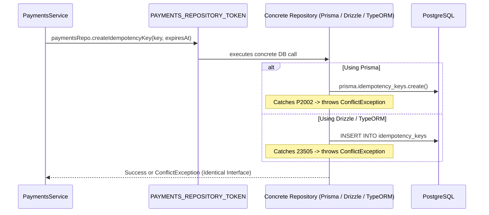

# ADR-014: Repository Pattern for Payments & Cross-ORM Portability

**Status:** Accepted  
**Date:** 2026-10-25  
**Decision Makers:** Architecture Team  
**Relates to:** ADR-009 (Webhook-Driven Payments), ADR-013 (Outbox Pattern for Payment Side-Effects)

---

## Context

### The Dual Coupling Problem
`PaymentsService` previously commingled high-level payment workflow orchestration (quote calculation, Stripe/eSewa signature validation, circuit breaking, webhook dispatch) with low-level database operations:
- Direct dependency on `PrismaService` (`prisma.orders.*`, `prisma.users.*`, `prisma.products.*`, `prisma.idempotency_keys.*`).
- Direct dependency on Prisma's interactive transaction mechanism (`prisma.$transaction(async (tx) => { ... })`).
- Direct invocation of raw SQL on `PostgresService` for inventory decrements.

### The ORM Lock-in Hazard (Why This Matters)
Every ORM in the Node.js/TypeScript ecosystem handles **transactions**, **connection pools**, and **idempotency constraint errors** in fundamentally different, incompatible ways:

| Feature | Prisma | TypeORM | Drizzle ORM | Kysely | Raw `pg` (Node Postgres) |
|---|---|---|---|---|---|
| **Transaction API** | `prisma.$transaction(async (tx) => ...)` | `dataSource.transaction(async (manager) => ...)` | `db.transaction(async (tx) => ...)` | `db.transaction().execute(async (trx) => ...)` | `client.query('BEGIN')` ... `COMMIT` |
| **Transaction Scope** | Rust engine holds interactive transaction handle | QueryRunner acquires dedicated connection | Lightweight wrapper over driver connection | Scoped transaction query builder | Explicit connection leased from PoolClient |
| **Transaction Timeout** | Configurable via options (defaults to 5000ms) | No automatic timeout (driver socket timeout) | Relies on database statement_timeout | Relies on statement_timeout | Relies on statement_timeout |
| **Unique Constraint Error** | `PrismaClientKnownRequestError` (`code === 'P2002'`) | `QueryFailedError` (`driverError.code === '23505'`) | Postgres error (`code === '23505'`) | Postgres driver error (`code === '23505'`) | Error with `code === '23505'` (SQLSTATE) |
| **Nested / Relational Inserts** | `order_items: { create: [...] }` | Cascade save on entity relation | Manual bulk insert or subqueries | Separate batched insert query | Separate `INSERT INTO order_items` |

If domain services directly call `prisma.$transaction` or catch Prisma-specific error codes like `P2002`:
1. Migrating to another ORM (e.g., Drizzle, TypeORM, Kysely) or microservice requires rewriting every single business service.
2. Unit tests cannot mock database transactions without complex stubs replicating Prisma's internal interactive client.
3. Database mechanics leak into commerce rules.

---

## Decision

**We decouple all persistence mechanics behind `IPaymentsRepository` and bind concrete implementations via NestJS Dependency Injection tokens (`PAYMENTS_REPOSITORY_TOKEN`).**

### Architectural Blueprint

```mermaid
graph TD
    subgraph Domain Layer
        PS[PaymentsService] -->|Depends strictly on| IPR[<<interface>> IPaymentsRepository]
    end

    subgraph Data Access Layer (Pluggable)
        IPR -.->|Current Implementation| PPR[PostgresPaymentsRepository]
        IPR -.->|Future / Alternate| DPR[DrizzlePaymentsRepository]
        IPR -.->|Future / Alternate| TPR[TypeORMPaymentsRepository]
        
        PPR --> PRISMA[PrismaService]
        PPR --> PG[PostgresService]
    end

    subgraph Database
        PRISMA --> DB[(PostgreSQL)]
        PG --> DB
    end
```

### Components and Responsibilities

1. **[IPaymentsRepository](file:///Users/mac/Developer/AI/ai-codebase-architect/backend/src/payments/repositories/payments.repository.interface.ts)**:
   - Declares domain persistence requirements (`findProductsByIds`, `createOrderSnapshot`, `findOrderByOrderNumber`, `markOrderAsPaidAtomic`, `checkIdempotencyKey`, `createIdempotencyKey`).
   - Declares the dependency injection token `PAYMENTS_REPOSITORY_TOKEN = Symbol('IPaymentsRepository')`.
2. **[PostgresPaymentsRepository](file:///Users/mac/Developer/AI/ai-codebase-architect/backend/src/payments/repositories/postgres-payments.repository.ts)**:
   - Contains all Prisma queries, transaction calls (`prisma.$transaction`), and ORM-specific error translation (e.g. mapping `P2002` to `ConflictException`).
3. **[PaymentsService](file:///Users/mac/Developer/AI/ai-codebase-architect/backend/src/payments/payments.service.ts)**:
   - Contains zero ORM imports, zero SQL statements, and zero transaction clients.
   - Operates purely on high-level domain workflows.

---

## How Transactions & Idempotency Are Handled Across ORMs

### 1. Atomic Outbox Transaction
The transaction boundary is encapsulated inside the repository method:
```typescript
await paymentsRepo.markOrderAsPaidAtomic({
  orderNumber,
  paymentIntentId,
  outboxEvent: { ... }
});
```
If the backend transitions from Prisma to Drizzle:
- In `PostgresPaymentsRepository` (Prisma): implemented with `this.prisma.$transaction(...)`.
- In `DrizzlePaymentsRepository`: implemented with `this.db.transaction(async (tx) => { ... })`.
- In `PaymentsService`: **0 lines of code change**.

### 2. Idempotency Key Semantics
Idempotency in relational databases is fundamentally guaranteed by the database engine via a **Unique Constraint Index** on the idempotency key column (`key VARCHAR UNIQUE`).
- **Prisma** throws `PrismaClientKnownRequestError` with `code: 'P2002'`.
- **PostgreSQL Native Driver (Drizzle, Kysely, TypeORM, pg)** throws an error with SQLSTATE `23505` (`unique_violation`).

The repository translates the ORM-specific error into a standard domain exception (`ConflictException('Webhook is already being processed')`). The caller never touches ORM error classes.

---

## Senior / Staff System Design Interview Talking Points & Follow-Up Q/A

### "Does each ORM have different methods for transaction idempotency?"

> "Yes. Every ORM implements transactions and error wrapping differently. Prisma uses a Rust query-engine binary that exposes an interactive transaction closure (`prisma.$transaction`), while TypeORM uses stateful `QueryRunner` connections and Drizzle provides direct SQL-dialect transaction closures. 
> Crucially, unique constraint violations (which idempotency depends on) produce different exception wrappers: Prisma wraps them in `PrismaClientKnownRequestError` with code `P2002`, whereas native PostgreSQL drivers throw error code `23505`.
> Without a Repository Pattern, your domain services become coupled to those ORM-specific error codes and transaction closures. If you switch ORMs, you would have to refactor every single service file. With the Repository Pattern, the repository absorbs the ORM-specific syntax and error translation, allowing the domain service to remain 100% agnostic."

### "What happens to transaction rollback guarantees if you swap ORMs?"

> "The ACID guarantee is provided by PostgreSQL, not the ORM. Whether using Prisma, TypeORM, Drizzle, or raw SQL, the underlying database command sequence is `BEGIN` → statements → `COMMIT` (or `ROLLBACK` on error). By confining the atomic unit of work to `markOrderAsPaidAtomic()`, the repository guarantees that the order status and outbox event commit together regardless of which library generates the SQL."

### "Why not use an Active Record or Unit of Work pattern instead?"

> "Active Record (e.g., standard TypeORM entities where `entity.save()` is called on the model) couples business logic directly to table schemas and database connections, making decoupled unit testing and swapping databases painful. The Data Mapper + Repository Pattern cleanly separates domain aggregates from database persistence models, which is essential for scalable modular monoliths."

---

## Mermaid Sequence Diagram: Swapping ORMs Seamlessly



---

*ADR-014 | Accepted | 2026-10-25*
