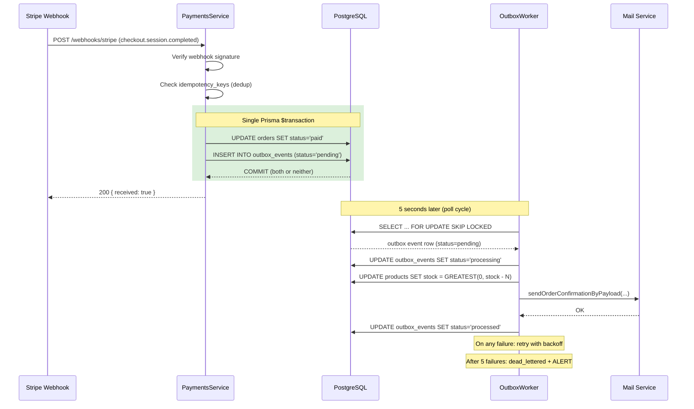

# ADR-013: Outbox Pattern for Payment Side-Effects

**Status:** Accepted  
**Date:** 2026-10-25  
**Decision Makers:** Architecture Team  
**Replaces:** N/A — addresses a gap not covered by ADR-009 (Webhook-Driven Payments)

---

## Context

### The Bug This ADR Fixes

Before this decision, `PaymentsService.markOrderAsPaid()` executed three sequential operations after a payment was confirmed:

```
1. UPDATE orders SET status = 'paid'   ← Postgres commit (irreversible)
2. UPDATE products SET stock = stock-N ← separate query (can fail)
3. mailService.sendOrderConfirmation() ← SMTP call (can fail)
```

**The problem:** Step 1 commits atomically. Steps 2 and 3 are independent network calls with no transactional guarantee. If either fails:

- The payment is confirmed and money has moved
- The customer receives no confirmation email
- Inventory is never decremented (oversell risk)
- There is no retry mechanism — the failure is silently logged and dropped

This is the **dual-write problem**: two systems (Postgres + external service) must both be updated, but there is no distributed transaction spanning both.

**This was a latent production bug.** It would not surface during normal operation. It surfaces when:
- SMTP server is temporarily down (common during deployments)
- Postgres replica lag causes a connection pool timeout on the inventory update
- The NestJS process crashes between step 1 and step 3

### Why This Is Critical for Payments Specifically

Payment events are the highest-consequence business events in the system. A failed inventory decrement means a product can be sold to more customers than exist in stock. A missed confirmation email means a customer who just paid has no evidence of their transaction — the first message they send support is "I paid but got nothing."

Neither of these is acceptable in a commerce system.

---

## Decision

**We implement the Transactional Outbox Pattern for all payment side-effects.**

### How It Works

```
┌─────────────────────────────────────────────────────────────┐
│  markOrderAsPaid() — ONE Prisma $transaction                │
│                                                             │
│  ┌─────────────────┐    ┌──────────────────────────────┐   │
│  │  UPDATE orders  │    │  INSERT INTO outbox_events   │   │
│  │  SET status=paid│    │  (aggregate_id, event_type,  │   │
│  │                 │    │   payload, status='pending') │   │
│  └────────┬────────┘    └──────────────┬───────────────┘   │
│           │                            │                   │
│           └──────────── COMMIT ────────┘                   │
│         Both succeed or both roll back                      │
└─────────────────────────────────────────────────────────────┘
                            │
                            ▼ (5 seconds later)
┌─────────────────────────────────────────────────────────────┐
│  OutboxWorker.poll()                                        │
│                                                             │
│  SELECT * FROM outbox_events                                │
│  WHERE status = 'pending'                                   │
│  FOR UPDATE SKIP LOCKED   ← safe for horizontal scaling     │
│                                                             │
│  For each event:                                            │
│    1. UPDATE products SET stock = GREATEST(0, stock - N)    │
│    2. mailService.sendOrderConfirmationByPayload(...)        │
│    3. UPDATE outbox_events SET status = 'processed'         │
│                                                             │
│  On failure: retry with exponential backoff                 │
│  After max_attempts: dead_letter + alert                    │
└─────────────────────────────────────────────────────────────┘
```

### Files Changed

| File | Change |
|---|---|
| `prisma/schema.prisma` | Added `outbox_events` model; added retry fields to `webhook_events`; removed duplicate `idx_orders_status_demo` |
| `src/database/migrations/002-outbox-and-webhook-retry.sql` | Raw SQL migration (safe, additive-only) |
| `src/payments/payments.service.ts` | `markOrderAsPaid()` now uses `prisma.$transaction` to atomically write order update + outbox event |
| `src/payments/outbox.worker.ts` | New NestJS provider — polls `outbox_events`, dispatches handlers, retries with backoff, dead-letters on permanent failure |
| `src/payments/payments.module.ts` | Registered `OutboxWorker` as a provider |

---

## The Dual-Write Problem — Why Simple Fixes Don't Work

### Option 1: Wrap everything in a try/catch and retry in-process
```typescript
// WRONG — does not help if the process crashes between steps
try {
  await order.save();
  await sendEmail(); // crashes here? email is lost forever.
} catch { retry(); }
```
An in-process retry is useless if the process itself crashes, restarts, or is killed by Kubernetes. The retry state is in memory — it disappears.

### Option 2: Use a message broker (Kafka, BullMQ) directly
```typescript
// WRONG — still a dual write
await order.save();          // step 1
await kafka.publish(event);  // step 2 — can fail after step 1 commits
```
Publishing to Kafka is a separate network call. Step 1 can succeed and step 2 can fail. You're back to the same problem with more infrastructure.

### Option 3: Outbox Pattern ✅
```typescript
// CORRECT — single transaction
await prisma.$transaction(async (tx) => {
  await tx.orders.update({ ... });     // step 1
  await tx.outbox_events.create({ ... }); // step 2 — same transaction
});
// If either fails, both roll back. The state is always consistent.
```

The outbox event and the business state change are **the same transaction**. They cannot diverge.

---

## Delivery Guarantee

**At-least-once delivery.** Not exactly-once.

The worker can process an event successfully (email sent, inventory decremented) and then crash before updating `status = 'processed'`. On restart, it will process the same event again.

**All handlers must be idempotent:**
- Inventory decrement uses `GREATEST(0, stock - N)` — safe to apply multiple times (won't go negative)
- Email: an extra confirmation email is annoying but not harmful. Future improvement: deduplicate on `(orderNumber, template_type)` before sending.

---

## Scale Boundaries

| Load | Behavior |
|---|---|
| < 1,000 orders/day | Polling every 5s is imperceptible overhead |
| 1,000–10,000 orders/day | Polling efficiently handled by partial index on `status = 'pending'` |
| > 50,000 orders/day | Evaluate moving to Postgres `LISTEN/NOTIFY` to reduce poll latency |
| > 500,000 events/day | Evaluate Kafka for cross-service fan-out; keep outbox for intra-service |

**Migration trigger:** If `outbox_events` backlog (unprocessed count) consistently exceeds 500 rows, the polling interval is too slow. Switch to `LISTEN/NOTIFY` or reduce poll interval to 1s before reaching for Kafka.

---

## FOR UPDATE SKIP LOCKED — Why This Matters for Scaling

The worker uses raw SQL `FOR UPDATE SKIP LOCKED` to claim outbox events. This is the correct primitive for distributed job queues in Postgres.

```sql
SELECT id, event_type, payload, attempts, max_attempts
FROM outbox_events
WHERE status = 'pending'
  AND (next_attempt_at IS NULL OR next_attempt_at <= NOW())
ORDER BY created_at ASC
LIMIT 10
FOR UPDATE SKIP LOCKED;  ← claim without blocking other workers
```

**What SKIP LOCKED does:**
- Worker A and Worker B both run this query simultaneously
- Worker A locks rows 1-10
- Worker B's query sees rows 1-10 are locked, skips them, locks rows 11-20
- Both workers process in parallel — zero coordination overhead, zero deadlocks

This is how BullMQ works under Redis. You can run multiple OutboxWorker instances (horizontal scaling) without any changes to the implementation.

---

## Dead-Letter Handling

When `attempts >= max_attempts` (default: 5), the event is moved to `dead_lettered` status and an `error` log is emitted with `action: 'MANUAL_INTERVENTION_REQUIRED'`.

**Required production integrations (not yet implemented):**
1. Alert on `outbox_events WHERE dead_lettered_at IS NOT NULL` — wire to PagerDuty/Slack
2. Admin endpoint `GET /admin/outbox/dead-letters` for support investigation
3. Admin endpoint `POST /admin/outbox/:id/retry` to re-queue a specific event

**Query for dead-lettered events:**
```sql
SELECT id, aggregate_id, event_type, last_error, dead_lettered_at, payload
FROM outbox_events
WHERE dead_lettered_at IS NOT NULL
ORDER BY dead_lettered_at DESC;
```

---

## Observability

Every outbox event transition is structured-logged with `event:` keys. Search in your logging platform:

| Log Event | Meaning |
|---|---|
| `outbox_batch_claimed` | Worker picked up N events |
| `outbox_event_processed` | Event fully dispatched and marked done |
| `outbox_event_retry_scheduled` | Handler failed, retry scheduled with backoff |
| `outbox_event_dead_lettered` | Permanently failed — manual action required |
| `order_paid_committed` | Atomic order+outbox write succeeded |
| `outbox_handling_order_paid` | Worker executing order.paid handlers |

**SLO to add:** P99 outbox processing latency < 30s. Alert if unprocessed `outbox_events` count > 100.

---

## Alternatives Considered

### Keep the direct side-effect calls but make them more robust
**Rejected.** No matter how robust you make the in-process call, you cannot survive a process crash between the DB commit and the side-effect execution. The outbox pattern is the only correct solution to this class of problem.

### Use BullMQ / Redis for the job queue
**Rejected (for now).** This adds a Redis dependency that is already used for caching. Mixing caching and queuing in the same Redis instance creates operational coupling. The Postgres outbox is sufficient at current scale and eliminates an infrastructure dependency.

**Reconsider when:** > 50k payment events/day, or when you need cross-service event fan-out.

### Use Kafka
**Rejected (for now).** Kafka is justified for cross-service event streaming at high volume. For intra-service side-effects (email + inventory), it is overengineered. Kafka adds: ZooKeeper/KRaft, broker cluster, consumer group management, schema registry. The outbox pattern achieves the same guarantee with a single table.

**Reconsider when:** You need multiple services to consume `order.paid` events independently, AND volume > 500k events/day.

---

## Senior / Staff System Design Interview Talking Points

### "Why not just use a message broker like Kafka here?"

> "The dual-write problem exists with any message broker too. Even with Kafka, you have: write to DB, then publish to Kafka — two separate operations. If the Kafka publish fails after the DB commit, you have the same consistency gap. The outbox pattern is the correct fix: you write the event record atomically with the business state change, then a separate process publishes it. This decouples the publish from the commit. Now you can use Kafka as the transport layer on top of the outbox, but the outbox is still the source of truth."

### "What delivery guarantee does this give you?"

> "At-least-once. Not exactly-once. The worker can execute a handler and crash before marking the event as processed. On restart, it processes again. This is why every handler must be idempotent. For inventory, GREATEST(0, stock - N) is idempotent. For email, a duplicate confirmation is a minor UX issue, not a data integrity issue. Exactly-once would require two-phase commit across the worker and the DB, which is expensive and complex — not worth it for email."

### "What happens if the outbox_events table itself grows unboundedly?"

> "Processed events accumulate. Two solutions: (1) A nightly cleanup job that deletes events older than 30 days with status='processed'. (2) Partition outbox_events by month so old partitions can be detached and dropped without a table lock. The partial index on status='pending' ensures the worker query performance is unaffected by historical data regardless of table size."

### "How do you scale the OutboxWorker horizontally?"

> "FOR UPDATE SKIP LOCKED. Each worker replica claims a different batch of rows atomically. There's no coordination protocol, no leader election, no ZooKeeper. Postgres locking handles it. You can run N replicas — each processes a different subset. The only limit is Postgres connection count, which PgBouncer handles."

### "What's the failure mode if the outbox table goes down?"

> "The `prisma.$transaction` in `markOrderAsPaid` will fail, rolling back the order status update too. The payment request returns a 500. The client (Stripe, eSewa) retries the webhook. We process it again. The outbox being unavailable temporarily prevents payment confirmation — it does not cause double-charges or inconsistent state. Availability degrades gracefully; consistency is preserved."

---

## Mermaid Diagram



---

*ADR-013 | Accepted | 2026-10-25*
