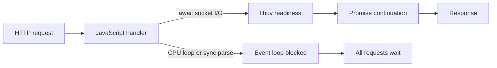

# Node.js runtime mechanics for backend engineers

The NestJS API is I/O-heavy: it coordinates PostgreSQL, payment providers, mail, and the Python AI service. The event loop keeps that concurrency inexpensive, but only while callbacks return control promptly.

## Event loop and libuv

JavaScript runs on the main thread. The event loop processes timers, pending callbacks, poll events, check callbacks, and close callbacks. Promise microtasks run between callback turns and can starve I/O if code continually schedules more microtasks. libuv uses the operating system for socket readiness and a bounded worker pool for selected filesystem, DNS, and crypto work.

`await` does not make CPU work parallel. Large JSON parsing, synchronous compression, and unbounded PDF processing can stall every request in the process. Move CPU-heavy work to a worker thread or the Python/RQ service, and bound input size before parsing.

## Streams and backpressure

Streams move data in chunks. Backpressure is the signal that a downstream consumer is slower than its producer. Use `pipeline()` so pressure and errors propagate through the chain; do not accumulate an unbounded response in an array or repeatedly call `write()` while `write()` returns false. For SSE, handle client disconnects and stop upstream generation when the consumer is gone.

## Memory and garbage collection

V8 uses a generational heap: short-lived objects are collected frequently, while survivors move into older generations. A rising heap after repeated traffic can indicate retained references, unbounded caches, listeners, or queued promises. Heap snapshots help find retainers; RSS also includes native buffers and library memory, so it can rise without the JavaScript heap rising equally. Apply payload limits and bounded queues before increasing `--max-old-space-size`.

## Async context, workers, and shutdown

`AsyncLocalStorage` can carry a request or trace identifier through asynchronous calls. Propagate the identifier to logs and downstream HTTP headers, but do not use it as a substitute for authenticated identity. Worker threads help CPU-bound JavaScript; they add message passing and memory overhead and are not a fix for database waits.

On SIGTERM, stop accepting new connections, stop scheduling background polls, allow in-flight work a bounded drain period, then close database pools and clients. Nest shutdown hooks must be enabled in bootstrap for lifecycle hooks to run on process signals. A drain timeout prevents a stuck request from holding a deployment indefinitely.

## Failure patterns and controls

Use request and upstream timeouts to bound wait time; retry only transient failures and only where the operation is idempotent. Exponential backoff needs jitter so replicas do not retry in lockstep. A circuit breaker can fail fast after repeated upstream failures, while a bulkhead limits how many requests can consume a dependency's capacity. These patterns do not replace per-request limits or cancellation.

## Common pitfalls

- Believing `async` makes CPU work non-blocking.
- Creating unbounded promise fan-out with `Promise.all` over arbitrary input.
- Retrying non-idempotent operations after a timeout whose outcome is unknown.
- Treating RSS as identical to V8 heap usage.
- Forgetting to stop timers and workers during shutdown.
- Streaming data without propagating cancellation or backpressure.

## Break It On Purpose

Start the backend locally with a disposable database. Add a temporary route in a throwaway branch that performs a large synchronous loop while a second terminal repeatedly requests `/health`; compare latency before and during the loop. Remove the route immediately. Then use the outbox worker's shutdown hook: start a long test handler, send SIGTERM, and confirm the worker stops polling and drains active work. Do not run the blocking route in a shared environment.

## Senior/Staff interview questions

1. **What runs JavaScript callbacks?** A single main-thread event loop per Node process.
2. **What does libuv do?** It provides cross-platform eventing and a worker pool for selected blocking operations.
3. **Why can a promise chain hurt latency?** CPU-heavy callbacks and endless microtasks prevent the loop from servicing I/O.
4. **When use worker threads?** For CPU-bound JavaScript that benefits from parallel execution and can tolerate message passing.
5. **What is backpressure?** A downstream signal to slow production when consumption cannot keep up.
6. **How do you distinguish heap growth from native memory?** Compare heap metrics and RSS, then inspect heap snapshots and native allocations.
7. **What belongs in graceful shutdown?** Stop new work, cancel polling, drain bounded in-flight work, and close dependencies.
8. **Why add jitter to retries?** It spreads synchronized retries and reduces bursts against an unhealthy dependency.
9. **When is a circuit breaker useful?** When repeated calls to a failing dependency waste capacity and add latency.
10. **What should happen when an SSE client disconnects?** Cancel upstream work and release stream resources promptly.
